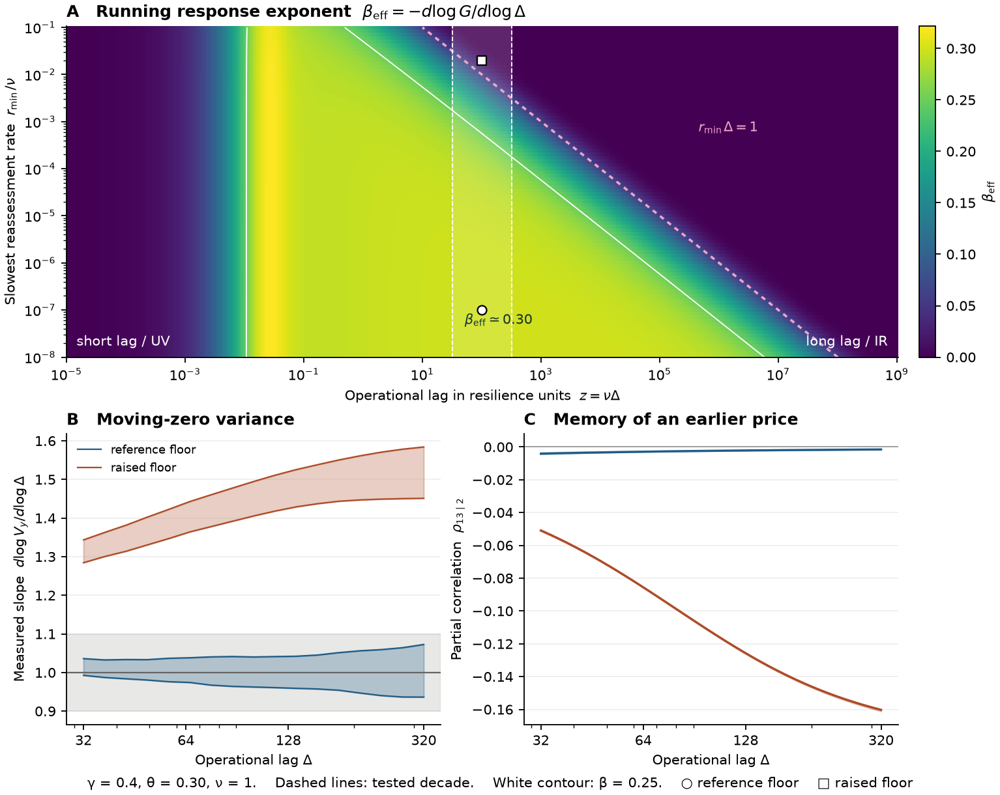

# Reaction-boundary volatility surface reproducibility bundle

Version: v1.7.0 accepted · v1.8.0 review edition

Supplementary code and materials for:

> Chris Angstmann and Tim Gebbie, **“Reaction-boundary variance and adjoint-consistent local-volatility projection,”** [arXiv:2607.05011v4](https://arxiv.org/abs/2607.05011v4).

The consolidated mathematical and computational supplement follows the frozen-boundary calculation through the translating zero, its response to liquidity reassessment and the variance of its increments. Section 16 introduces the operational-scale regime map and tests how much an earlier price adds once the present price is known.

> [Supplement v1.8.0 (PDF)](supplementary-materials/ReactionBoundaryVolSurface-Supplement-v1.8.0.pdf) · [Consolidated LaTeX source](supplementary-materials/ReactionBoundaryVolSurface-Supplement-v1.8.0.tex) · [Historical supplement to v1.0.0](supplementary-materials/ReactionBoundaryVolSurface-Supplement-v0.1.pdf)

This repository is a quantitative-finance reproducibility bundle. Its purpose is to show how the reaction-boundary variance construction generates projected local-volatility surface shapes from liquidity, resilience, and response terms. The code is included so that the figures, tables, diagnostics, and sensitivity checks can be regenerated from the same parameter profiles used in the supplementary materials. This is slightly over-engineered so that it can be easily extended for more sophisticated simulation and calibration work if required. 

## Key figure: the operational-scale regime map

[](figures/v2/scale-window.pdf)

**Figure. The intermediate response window of the aligned translating boundary.** Panel A shows the displacement-response exponent $`\beta_{\mathrm{eff}}`$ against operational lag $`z=\nu\Delta`$ and the slowest reassessment rate $`r_{\min}/\nu`$. The diagonal $`r_{\min}\Delta=1`$ marks one relaxation time of the slowest mode. Panel B tests the response against an independent measurement of the moving zero. Across lags 32–320, the variance-slope envelope is 0.937–1.073 at the reference rate floor and rises to 1.285–1.584 when the slowest relaxation enters the window. Panel C measures the dependence between earlier and later prices after conditioning on the present price, at equal operational-time separations. The reference case combines approximately linear variance growth with little residual price memory on the tested scales. A Markov description of the nonlinear zero remains open. [Supplement §§16.1–16.2](supplementary-materials/ReactionBoundaryVolSurface-Supplement-v1.8.0.tex#L1287) · [Vector figure](figures/v2/scale-window.pdf)

## The physics

### From the structural surfaces to the frozen variance (v1.0.0–v1.1.0)

The first calculation asks how liquidity slope, forcing intensity and resilience shape the projected surface. For the stationary frozen boundary let $`V_\Delta`$ be the variance of a log-price increment over an operational lag $`\Delta`$. The variance per unit operational time has the separated-scale form

```math
\frac{V_\Delta}{\Delta}\simeq
\frac{\mathcal A_{\mathrm{eff}}}{\mathcal L^2}\cdot\Delta^{-\gamma}
\mathcal F_\gamma(\nu\Delta).
```

The dimensionless lag $`z=\nu\Delta`$ compares the observation interval $`\Delta`$ with the liquidity replenishment time $`\nu^{-1}`$. On the ultraviolet (short-time) side of this crossover, $`\tau_0\ll\Delta\ll\nu^{-1}`$. The boundary responds to persistent signed order flow before liquidity has time to replenish, giving $`V_\Delta\propto\Delta^{1-\gamma}`$. Resilience therefore drops out of the leading variance law, and the microscopic cutoff $`\tau_0`$ sets the lower limit of this scaling window. On the infrared (long-time) side, $`z\gg1`$, replenishment limits the displacement of the frozen boundary. Its increment variance approaches twice the stationary level variance, so the variance per unit operational time falls as $`1/\Delta`$. This distinction motivates the proposed renormalisation-group calculation for the translating boundary: when fast liquidity-reassessment modes are integrated out, which memory terms must be retained to reproduce the root response at lower frequencies?

A state-conditioned local-pricing coefficient requires additional information even when the stationary variance is known. The accepted W01 calculation checks the finite-cutoff result in both time and frequency. [Supplement §3, including the finite-cutoff comparison](supplementary-materials/ReactionBoundaryVolSurface-Supplement-v1.8.0.tex#L144)

### From a frozen zero to a translating root (v1.2.0)

When the deposition profile follows the observed zero, the auxiliary field admits translated profiles $`\Phi_{\ast}(x-q)`$. Their tangent $`\psi=-\Phi_{\ast}'`$ is a neutral mode. The transverse spectrum lies at or below $`-\nu`$. For initial data on this family and forcing aligned with $`\psi`$, the observed root is exactly $`y=q`$. A shape perturbation with zero spectral phase can still move the observed zero. This distinction determines which coordinate must be measured in later variance tests. [Supplement §10, translating profile and observed zero](supplementary-materials/ReactionBoundaryVolSurface-Supplement-v1.8.0.tex#L532)

### What would carry the result to v2.0.0?

The proposed extension asks whether delayed liquidity reassessment can compensate persistent order flow over a common interval of operational lags. Write $`H(s)`$ for the transfer from signed input to root **velocity**. The impulse response of the **root displacement** has transform $`\widehat G_{\mathrm{eff}}(s)=H(s)/s`$. The response slope and the balance to be tested are

```math
\beta_{\mathrm{eff}}(\Delta)=-\frac{d\log |G_{\mathrm{eff}}(\Delta)|}{d\log\Delta}
```

```math
B(\Delta)=2\beta_{\mathrm{eff}}(\Delta)+\gamma-1.
```

v1.3.0 measures the causal transfer and the error from eliminating fast reassessment rates. v1.4.0 independently estimates the input exponent $`\gamma`$. v1.5.0 measures the aligned actual-root increment variance $`V_y(\Delta)`$, and a positive, approximately constant $`V_y(\Delta)/\Delta`$ on the same prespecified interval. Off-match rates, a finite slow-rate floor and non-aligned forcing test the limits of the construction. If these observations disagree, that disagreement belongs in the v2.0.0 result. The feedback spectrum is prescribed in this construction. v1.6.0 measures the transverse contribution in a specified linearised field. The v1.7.0 calculation observes the nonlinear zero directly. Section 16 follows the same nonlinear paths under finer spatial and temporal resolution. The paths converge to the stated displacement tolerance, while each tested nonlinear case retains lags outside the variance-slope band. Deriving the reassessment spectrum from bid and ask kinetics remains open. [Supplement §§11–16](supplementary-materials/ReactionBoundaryVolSurface-Supplement-v1.8.0.tex#L606)

### Structural volatility surface at high <i>z</i>


**Figure. Combined structural reaction-boundary volatility surface under the high-<i>z</i> response regime.** Panel A gives the boxed surface view of the projected local volatility $`\sigma_{\mathrm{loc}}`$ over log-moneyness $`m=\ln(x/x_0)`$ and maturity $`T`$. Panel B gives the corresponding black-line contour projection of the same surface. Both views show the skew generated by the prescribed liquidity and resilience profiles. The high-<i>z</i> case emphasises the response-sensitive regime in which liquidity, resilience, and the structural response profile combine to produce a persistent skew-like surface over maturity. The contour view is included because it is easier to compare shape, monotonicity, and curvature across regimes without the visual distortion of a 3D perspective plot.

The combined high-<i>z</i> figure uses the profile definitions and the high-<i>z</i> asymptote in the v1.0.0 structural-surface calculation. The sensitivity summary reports the numerical characteristics of all six surfaces. [Supplement §8.3](supplementary-materials/ReactionBoundaryVolSurface-Supplement-v1.8.0.tex#L468) · [Profile definitions](config/profile-definitions-v1.json) · [Sensitivity summary](outputs/stage09-sensitivity-summary-v1.csv) · [Figure register](figure-table-provenance-register.csv)

## Current situation: v1.8.0 review candidate

The regime map is accepted as the principal figure. The v1.8.0 calculation is under review. The latest accepted scientific checkpoint is v1.7.0.

**Evidence inventory**

| Version | Calculation | Finding | Evidence |
|---|---|---|---|
| **v1.8.0 (candidate)** | Operational scale and price memory | All 32 paths met the refined displacement tolerance. Each nonlinear case still has lags outside the diffusion-slope band. | [Scale map](figures/v2/scale-window.pdf) · [Supplement §16](supplementary-materials/ReactionBoundaryVolSurface-Supplement-v1.8.0.tex#L1274) |
| v1.7.0 | Nonlinear moving zero | All 192 trajectories kept a unique zero. Only 20 of 32 baseline paths met the displacement tolerance. | [Supplement §15](supplementary-materials/ReactionBoundaryVolSurface-Supplement-v1.8.0.tex#L1120) · [Resolution](outputs/v2/nonlinear-field-audit.csv) |
| v1.6.0 | Phase and shape | Reversing forcing placement reverses the covariance sign. No projected case met both scaling criteria. | [Supplement §14](supplementary-materials/ReactionBoundaryVolSurface-Supplement-v1.8.0.tex#L1004) · [Lag results](outputs/v2/phase-shape-window.csv) |
| v1.5.0 | Aligned moving zero | Both matched cases passed the variance test across the decade. All four primary offset tests remained inconclusive. | [Supplement §13](supplementary-materials/ReactionBoundaryVolSurface-Supplement-v1.8.0.tex#L838) · [Lag results](outputs/v2/root-variance-window.csv) |
| v1.4.0 | Forcing and response | Both prescribed matches passed at all 17 lags. One of four primary offsets separated across the window. | [Supplement §12](supplementary-materials/ReactionBoundaryVolSurface-Supplement-v1.8.0.tex#L712) · [Measurements](outputs/v2/balance-window.csv) |
| v1.3.0 | Reassessment and memory | The aligned response agrees with independent pole inversion to within 4.02 × 10⁻⁹ on the tested lags. | [Supplement §11](supplementary-materials/ReactionBoundaryVolSurface-Supplement-v1.8.0.tex#L606) · [Fast-rate error](outputs/v2/feedback-shell.csv) |
| v1.2.0 | Translating front | Translation has a neutral mode. Transverse modes have a resilience gap and can displace the measured zero. | [Supplement §10](supplementary-materials/ReactionBoundaryVolSurface-Supplement-v1.8.0.tex#L532) · [Spectrum](figures/v2/translation-modes.svg) |
| v1.1.0 | Frozen boundary | Time and frequency calculations agree to within 3.84 × 10⁻¹¹ in relative variance across 48 cases. | [Variance checks](outputs/v2/frozen-variance-checks.csv) · [Crossover](figures/v2/response-crossover.svg) |
| v1.0.1 | Historical replay | All 42 diagnostics and 19 sensitivity checks passed. The audit identifies differences between the staged archive and tagged source. | [Preservation audit](docs/audits/baseline-v1.0.0.md) |
| v1.0.0 | Published structural surfaces | Three liquidity and resilience profiles generate low- and high-<i>z</i> surface and contour pairs. | [Figures](figures) · [Published release](https://github.com/timgebbie/reaction-boundary-vol-surface-reproducibility/releases/tag/v1.0.0) |

### Theoretical antecedents

| Source | Result used here |
|---|---|
| [Angstmann and Gebbie, arXiv:2607.05011v4](https://arxiv.org/abs/2607.05011v4) | Frozen-boundary variance and local-volatility projection, Eqs. (21) and (47). Appendix D specifies the Gaussian tangent-state conditioning. |
| [Supplement §§10–11](supplementary-materials/ReactionBoundaryVolSurface-Supplement-v1.8.0.tex#L532) | Translation of the observed zero, its neutral mode and the causal response induced by liquidity reassessment. |
| [Supplement §§12–14](supplementary-materials/ReactionBoundaryVolSurface-Supplement-v1.8.0.tex#L712) | Response balance, independent measurement of aligned-root variance and signed covariance between phase and shape. |
| [Supplement §§15–16](supplementary-materials/ReactionBoundaryVolSurface-Supplement-v1.8.0.tex#L1120) | Nonlinear root dynamics, the operational-scale regime map and conditional price memory. |

## Future situation: possible extensions

### Planned checkpoints through v2.0.0

| Checkpoint | Scientific question or evidence |
|---|---|
| v1.0.1 and v1.1.0 (accepted) | Replay the released surfaces and verify the frozen, finite-cutoff boundary variance independently in frequency and time. |
| v1.2.0 (accepted) | Resolve the translation mode and stable shape spectrum, and test the exact aligned moving root. |
| v1.3.0 (accepted) | Introduce prescribed liquidity feedback and quantify the response error from eliminating fast rates. |
| v1.4.0 (accepted) | Measure the integrated root propagator and input memory independently to test the Bouchaud balance. |
| v1.5.0 (accepted) | Measure actual-root variance on the same prespecified operational-time window, including off-match and finite-rate-floor controls. |
| v1.6.0 (accepted) | Measure signed phase–shape covariance under independent and common driving. |
| v1.7.0 (accepted) | Test root preservation and convergence for the nonlinear, non-aligned field. |
| v1.8.0 and v1.9.x | Compare mechanisms and controls, then audit claims and reproduce the expanded supplement from a clean checkout. |
| v2.0.0 | Assemble the verified results and their limits in a citable code and supplement milestone, subject to approval. |

### Beyond v2.0.0: an effective field theory from bid and ask liquidity

Can the separately evolving bid and ask densities, with depletion and delayed, displaced replenishment, supply the kinetics for an effective theory of the moving boundary? A first comparison would extract the zero of the simulated signed imbalance wherever it is unique and simple, and measure its displacement alongside the threshold-quote log midpoint and quoted spread on the same operational clock. The difference between the root and the midpoint would itself be an observable. Matched perturbations of replenishment placement or delay could then test whether a single boundary coordinate predicts the measured response, or whether spread or pending replenishment must remain explicit slow variables. A further question is whether the measured relaxation spectrum accounts for the feedback law currently prescribed in the auxiliary model. [Two-field spread paper](https://arxiv.org/abs/2610.07985) · [Simulated density paths, quotes and controls](https://github.com/timgebbie/two-field-spread-reproducibility)

### Other possible extensions

- **Can observed order flow explain the imposed liquidity, resilience and forcing profiles?** The six structural surfaces use declared synthetic profiles. The [sensitivity summary](outputs/stage09-sensitivity-summary-v1.csv) shows how the surface changes when these inputs vary. Estimate the profiles from book and order-flow data. Test their predictive content on held-out observations.
- **Are the low- and high-<i>z</i> regimes observable in market data?** W01 resolves the frozen-response crossover in $`z=\nu\Delta`$ under controlled parameters. Estimate resilience and the observation scale on a common operational clock and test whether the two regimes can be distinguished statistically.
- **How do persistent order flow and replenishment affect the moving root?** W01 establishes the frozen variance. W02 separates translation and shape, and tests the aligned root. W03–W04 establish the response of the aligned construction to prescribed feedback. W05 tests the input and response slopes independently. W06 measures the moving-zero variance. W07–W09 address the covariance of phase and shape and the placement of forcing. A kinetic derivation from bid and ask liquidity remains the separate question above.
- **Can the structural surface be compared quantitatively with option-implied local volatility?** The existing plots illustrate surface shape. The stationary high-<i>z</i> coefficient has an unconditional interpretation. Specify the pricing measure and state conditioning, map state and maturity coordinates, and quantify the effect of no-arbitrage projection or regularisation before making a calibration claim.
- **How sensitive are the conclusions to the response law?** The historical workflow already includes 19 sensitivity checks. W09 addresses alternative rate spectra, finite rate floors, and forcing alignment. Broader empirical kernel and profile comparisons remain open.

Packaging, command-line entry points, notebooks, continuous integration and a fully locked environment remain possible software improvements. The scientific checkpoints above use the documented script entry points and recorded replay environment.

## Scientific boundary

The code simulates projected structural volatility surfaces from the reaction-boundary variance construction. It does not estimate a calibrated Dupire local-volatility surface from market option data. The local-volatility comparison in the supplement is qualitative and phenomenological.

The high-<i>z</i> figures illustrate the unconditional stationary variance response. Using that response as a state-conditioned pricing coefficient requires separate justification.

## Repository structure

```text
VERSION_POLICY.md        Checkpoint acceptance, tags and major releases
tests/                   Claim-bearing numerical checks for the extension
docs/audits/             Baseline replay and checkpoint evidence
outputs/v2/              Supplement extension data, including pre-v2.0.0 work
figures/v2/              Supplement extension figures
config/                  Parameter ranges and profile definitions
functions/               Reusable numerical helpers
scripts/                 Active v1.0 reproducibility scripts
data/                    Data instructions; no empirical data are required
figures/                 Preferred generated v3 figure outputs and README figure
tables/                  Generated CSV and LaTeX tables
diagnostics/             Diagnostic and sensitivity-check reports
outputs/                 Sensitivity summary outputs
captions/                Standalone caption drafts for generated figures
supplementary-materials/ Supplementary-materials TeX and PDF
provenance/              Stage notes, audits, registers, source freeze, legacy scripts
```

## Installation

The historical Windows author run used Python 3.13.9. The November replay and v1.1.0–v1.8.0 calculations used Linux, Python 3.12.14, NumPy 2.3.5, SciPy 1.17.0 and Matplotlib 3.11.0. The requirements files specify the supported installation constraints. The exact versions above identify the recorded run.

### Obtain the scientific source

```bash
git clone https://github.com/timgebbie/reaction-boundary-vol-surface-reproducibility.git
cd reaction-boundary-vol-surface-reproducibility
git checkout main
```

For the accepted v1.7.0 calculation, use commit `f83f8690c45505b5f73cbc9a2a707dc88d0faf32`. For the original published surfaces alone, use the same repository at tag `v1.0.0`.

### Install dependencies

From a fresh clone:

```bash
python -m venv .venv
```

Activate the environment.

On Windows PowerShell:

```powershell
.venv\Scripts\Activate.ps1
```

On Windows CMD:

```cmd
.venv\Scripts\activate.bat
```

On macOS/Linux:

```bash
source .venv/bin/activate
```

Then install the requirements:

```bash
python -m pip install --upgrade pip
python -m pip install -r requirements.txt
```

For the finite-cutoff comparison and the extension tests, install the additional response requirements in the same environment:

```bash
python -m pip install -r requirements-response.txt
```

## Reproducing the accepted outputs

### Inputs and configuration

| Input | Source / location | Version or fingerprint | Access conditions |
|---|---|---|---|
| Structural profiles and parameter ranges | [Profiles](config/profile-definitions-v1.json) · [Ranges](config/parameter-ranges-v1.csv) | Released v1.0.0 Git tree | Public synthetic inputs. |
| Frozen-variance quadrature and parameter grid | [Calculation](functions/frozen_response.py) · [Experiment](scripts/run_frozen_response.py) | v1.1.0 source in the version table | Deterministic calculation. The grid and numerical tolerances are given in the audit. |

### Reproducing the active outputs

Run the convenience wrapper:

```bash
python scripts/run_all.py
```

or run the scripts explicitly:

```bash
python scripts/03_run_diagnostics.py
python scripts/01_make_tables.py
python scripts/05_generate_matplotlib_figures_v3.py
python scripts/06_run_sensitivity_checks.py
```

Running the active route regenerates or checks:

- tables in `tables/`;
- preferred v3 figures in `figures/`;
- diagnostics in `diagnostics/`;
- sensitivity summaries in `outputs/`;
- figure captions in `captions/`.

### Frozen variance, translating front, response and moving-zero variance

```bash
python -W error -m unittest discover -s tests -v
python -W error scripts/run_frozen_response.py
python -W error scripts/run_translating_front.py
python -W error scripts/run_liquidity_feedback.py
python -W error scripts/run_response_balance.py
python -W error scripts/run_root_variance.py
python -W error scripts/run_phase_shape.py
python -W error scripts/run_nonlinear_field.py
python -W error scripts/check_nonlinear_speed.py
OPENBLAS_NUM_THREADS=1 python -W error scripts/run_scale_window.py
OPENBLAS_NUM_THREADS=1 python -W error scripts/run_matched_refinement.py
```

| Output | Location | Format | Acceptance criterion |
|---|---|---|---|
| Six structural surfaces and sensitivity summary | [Figures](figures) · [Summary](outputs/stage09-sensitivity-summary-v1.csv) | PNG, PDF, CSV | Baseline diagnostics and sensitivity checks, with rendering and rounding differences recorded. |
| Finite-cutoff coefficient | [Comparisons](outputs/v2/frozen-variance-checks.csv) | CSV | Relative discrepancy and refinement changes below $`10^{-6}`$ for each of 48 cases. |
| Crossover and its running slope | [Figure](figures/v2/response-crossover.svg) · [Data](outputs/v2/response-crossover.csv) | SVG, CSV | Low- and high-<i>z</i> checks against Eq. (22), using the tolerances in the [tests](tests/test_frozen_response.py). |
| Translating front | [Field and root tests](docs/audits/translating-front-v1.2.0.md) · [Root residuals](outputs/v2/aligned-root-checks.csv) | CSV, SVG | On the finest grid the aligned weak residual was $`3.16\times10^{-5}`$ and the displaced-forcing control gave 0.218. |
| Causal feedback | [Frequency](outputs/v2/feedback-frequency.csv) · [Time](outputs/v2/feedback-time.csv) · [Shell](outputs/v2/feedback-shell.csv) | CSV, SVG | At cutoff 2 the first-derivative memory has maximum relative transfer error 0.0002532 on the retained band. |
| Matched and offset response | [Window estimates](outputs/v2/balance-window.csv) | CSV | Two prescribed matches pass the response criterion. |
| Aligned moving zero | [Per-design variances](outputs/v2/root-variance-designs.csv) · [Joint lag table](outputs/v2/root-variance-window.csv) | CSV, SVG | Both matched root-variance intervals pass on the accepted common window. |
| Phase and shape | [Per-design comparisons](outputs/v2/phase-shape-designs.csv) · [Whole-window outcomes](outputs/v2/phase-shape-window.csv) | CSV, SVG | All 612 expected cross terms lie inside the corresponding design intervals. Two additive configurations meet both scaling criteria. |
| Nonlinear moving zero | [Fields, speeds and lag estimates](docs/audits/nonlinear-field-v1.7.0.md) | CSV, SVG | Five output CSVs and the figure reproduced byte for byte from clean source. |
| Operational-scale regime map and matched refinement | [Regime map](figures/v2/scale-window.pdf) · [Response grid](outputs/v2/response-surface.csv) · [Refinement](outputs/v2/matched-field-refinement.csv) | PNG, PDF, CSV | Six tables and both figure formats reproduced byte for byte in the recorded environment. |

### Repeating the analysis in an already-used tree

The same commands regenerate the derived files in place. Use the reference checkout above to compare against the accepted outputs. For an existing checkout, inspect local edits before rerunning the figure and table scripts.

## Verification status

| Check category | Command or evidence record | Result |
|---|---|---|
| Environment and dependencies | [Baseline replay](docs/audits/baseline-v1.0.0.md) · [Finite-cutoff run](docs/audits/frozen-response-v1.1.0.md) | Recorded on 22 November 2026. |
| Unit and scientific regression | v1.7.0 scientific suite | All 29 tests passed with warnings treated as errors, including checks of root interpolation, fractional lag increments and spectral normalisation. |
| Review-edition regression | v1.8.0 scientific suite | All 33 tests passed with warnings treated as errors. |
| Source integrity | [Archived file and checksum reconciliation](docs/audits/baseline-v1.0.0.md) | Frozen TeX and BibTeX verified. The staged inventory differs from the Git tree. |
| Clean source reproduction | Independent checkout of the v1.5.0 source | The response and root-variance CSVs and SVGs reproduced byte-for-byte with single-threaded BLAS. Changing BLAS threading moved two earlier time-response columns by at most 1.12 × 10⁻¹⁶. All 61 historical checks passed. |
| Cross-platform evidence | [Original author and clean-clone report](TEST-REPORT-v1.0.md) | Windows evidence applies to the historical route. The extension was verified on Linux. |

### Execution gates passed

The reduced v1.0 bundle has passed two execution gates:

1. **Author local execution gate:** Windows, Python 3.13.9, `venv` under an Anaconda installation. The author confirmed successful completion of Stage 7 diagnostics, Stage 8 table generation, Matplotlib v3 figure generation, and Stage 9 sensitivity checks.
2. **Private GitHub clean-clone gate:** the private GitHub repository was cloned into a fresh directory, dependencies were installed into a fresh virtual environment, and `python scripts/run_all.py` completed successfully.

The expected final status line is:

```text
Active v1.0 reproducibility route completed successfully.
```

The original staged workspace recorded:

- Stage 7 diagnostics: 42 checks, 0 failures;
- Stage 9 sensitivity checks: 19 checks, 0 failures.

### Note on regenerated PDF figures

Running the figure-generation script may cause Git to mark generated PDF figures as modified even when the run has succeeded. This is expected: Matplotlib PDF output can differ byte-for-byte across local systems because of backend metadata, font embedding, or rendering details. The reproducibility claim is that the scripts regenerate the intended scientific figures, tables, diagnostics, and sensitivity checks; it is not a claim of byte-identical PDF files across all machines.

## Version-control and release policy

Development proceeds on `main`. Accepted checkpoints can receive immutable version tags. GitHub releases require a separately approved major scientific or reproducibility milestone. See the [version policy](VERSION_POLICY.md).

| Version or stage | Verified change | Evidence / status | Release reference |
|---|---|---|---|
| v1.0.0 | Original structural surfaces, diagnostics and v0.1 supplement | Published reproducibility baseline | [Tag and GitHub release](https://github.com/timgebbie/reaction-boundary-vol-surface-reproducibility/releases/tag/v1.0.0) · [`ee37d99`](https://github.com/timgebbie/reaction-boundary-vol-surface-reproducibility/commit/ee37d994b72b64395560de1126531bb259c1f794) |
| v1.0.1 | Historical replay, source map and checksum reconciliation | Accepted preservation checkpoint · [audit](docs/audits/baseline-v1.0.0.md) | [`48aad39`](https://github.com/timgebbie/reaction-boundary-vol-surface-reproducibility/commit/48aad392734a228455df743d1c9a6453c4fecee8) · commit on GitHub |
| v1.1.0 | Exact finite-cutoff cumulant, independent time-domain check and zero-cutoff crossover | Accepted scientific checkpoint · [audit](docs/audits/frozen-response-v1.1.0.md) | [`33332cf`](https://github.com/timgebbie/reaction-boundary-vol-surface-reproducibility/commit/33332cfd7ce707079e6bac288b739aa28d6837bd) · commit on GitHub |
| v1.2.0 | Translating profile, pinned control, stable shape band and measured root | [Computational audit](docs/audits/translating-front-v1.2.0.md) · accepted scientific checkpoint | [`b65bf06`](https://github.com/timgebbie/reaction-boundary-vol-surface-reproducibility/commit/b65bf066e28466faa6781548a1f21e1b994e780c) |
| v1.3.0 | Causal root response and fast-rate memory | [Finite-rate and shell audit](docs/audits/liquidity-feedback-v1.3.0.md) · accepted scientific checkpoint | [`fcc1f40`](https://github.com/timgebbie/reaction-boundary-vol-surface-reproducibility/commit/fcc1f40cb7b401c2408f13a324ed06e0e97261ef) |
| v1.4.0 | Independent response balance on a fixed operational window | [Measurements and controls](docs/audits/response-balance-v1.4.0.md) · accepted scientific checkpoint | [`1052471`](https://github.com/timgebbie/reaction-boundary-vol-surface-reproducibility/commit/10524718cda8aa53bc605a3f8bce49f79f99c03f) |
| v1.5.0 | Independent moving-zero variance | [Variance and spectral checks](docs/audits/actual-root-variance-v1.5.0.md) · accepted scientific checkpoint | [`3ea466e`](https://github.com/timgebbie/reaction-boundary-vol-surface-reproducibility/commit/3ea466ecb17673b7d695efde696bab26a591479a) |
| v1.6.0 | Signed phase–shape covariance | [Decomposition and numerical checks](docs/audits/phase-shape-v1.6.0.md) · accepted scientific checkpoint | [`018d011`](https://github.com/timgebbie/reaction-boundary-vol-surface-reproducibility/commit/018d01162f09d2986c937c286297ec966d437bda) |
| v1.7.0 | Nonlinear field, measured root and travelling speed | [Convergence and controls](docs/audits/nonlinear-field-v1.7.0.md) · accepted scientific checkpoint | [`f83f869`](https://github.com/timgebbie/reaction-boundary-vol-surface-reproducibility/commit/f83f8690c45505b5f73cbc9a2a707dc88d0faf32) |

The public tag and hosted release at the 22 November audit were both v1.0.0. The v0.1 supplement, the paper revision and the dated inputs and figure families each retain their own identifiers. The `v2/` output directories identify work towards the expanded supplement.

## Release archive and provenance

| Record | Reference | Scope |
|---|---|---|
| Archived software | [ZivaHub deposit](https://doi.org/10.25375/uct.32936867), `ReactionBoundaryVolSurface-Reproducibility-v1.0-stage5.zip` | Staged v1 software deposit. |
| Released Git source | [v1.0.0](https://github.com/timgebbie/reaction-boundary-vol-surface-reproducibility/releases/tag/v1.0.0) · [Release notes](RELEASE-NOTES-v1.0.md) | Reduced public repository and historical supplement. |
| Inventory | [Staged checksums](FILE-MANIFEST-SHA256.csv) · [Current source map](reproducibility-manifest.md) | Of 132 staged entries, 98 match tagged Git bytes, six match with CRLF conversion, 27 differ and one file is absent. |
| Frozen-response extension | [v1.1.0 source](https://github.com/timgebbie/reaction-boundary-vol-surface-reproducibility/tree/33332cfd7ce707079e6bac288b739aa28d6837bd) | Accepted mainline computation. The v1 deposit describes the staged historical archive. |
| Translating-front extension | [`b65bf06`](https://github.com/timgebbie/reaction-boundary-vol-surface-reproducibility/commit/b65bf066e28466faa6781548a1f21e1b994e780c) | Accepted W02 source, including the integrated clean replay. |
| Causal liquidity reassessment | [`fcc1f40`](https://github.com/timgebbie/reaction-boundary-vol-surface-reproducibility/commit/fcc1f40cb7b401c2408f13a324ed06e0e97261ef) | Accepted transfer, time-response and shell-reduction source and consolidated supplement. |
| Independent response balance | [`1052471`](https://github.com/timgebbie/reaction-boundary-vol-surface-reproducibility/commit/10524718cda8aa53bc605a3f8bce49f79f99c03f) | Input path estimates, collective response, all controls and consolidated supplement. |
| Moving-zero variance | [`3ea466e`](https://github.com/timgebbie/reaction-boundary-vol-surface-reproducibility/commit/3ea466ecb17673b7d695efde696bab26a591479a) | Accepted common-window root variance, controls and consolidated supplement. |
| Signed phase–shape covariance | [`018d011`](https://github.com/timgebbie/reaction-boundary-vol-surface-reproducibility/commit/018d01162f09d2986c937c286297ec966d437bda) | Common-input and independent benchmarks, projected field and consolidated supplement. |
| Nonlinear moving boundary | [`f83f869`](https://github.com/timgebbie/reaction-boundary-vol-surface-reproducibility/commit/f83f8690c45505b5f73cbc9a2a707dc88d0faf32) | Accepted unique-root evidence, matched pathwise resolution, speed benchmark and consolidated supplement. |

## DOI, citation, and license

Registered ZivaHub/Figshare DOI:

https://doi.org/10.25375/uct.32936867

Suggested citation:

Gebbie, Tim and Angstmann, Chris (2026). *Reaction-boundary volatility surface reproducibility code for arXiv:2607.05011*. University of Cape Town. Software. https://doi.org/10.25375/uct.32936867

| Item | Value |
|---|---|
| Associated paper | [arXiv:2607.05011v4](https://arxiv.org/abs/2607.05011v4) |
| Historical supplement v0.1 | [ReactionBoundaryVolSurface-Supplement-v0.1.pdf](supplementary-materials/ReactionBoundaryVolSurface-Supplement-v0.1.pdf) |
| Translating-front supplement v1.2.0 | [PDF](supplementary-materials/ReactionBoundaryVolSurface-Supplement-v1.2.0.pdf) · [TeX](supplementary-materials/ReactionBoundaryVolSurface-Supplement-v1.2.0.tex) |
| Causal reassessment supplement v1.3.0 | [PDF](supplementary-materials/ReactionBoundaryVolSurface-Supplement-v1.3.0.pdf) · [TeX](supplementary-materials/ReactionBoundaryVolSurface-Supplement-v1.3.0.tex) |
| Response-balance supplement v1.4.0 | [PDF](supplementary-materials/ReactionBoundaryVolSurface-Supplement-v1.4.0.pdf) · [TeX](supplementary-materials/ReactionBoundaryVolSurface-Supplement-v1.4.0.tex) |
| Moving-zero supplement v1.5.0 | [PDF](supplementary-materials/ReactionBoundaryVolSurface-Supplement-v1.5.0.pdf) · [TeX](supplementary-materials/ReactionBoundaryVolSurface-Supplement-v1.5.0.tex) |
| Covariance supplement v1.6.0 | [PDF](supplementary-materials/ReactionBoundaryVolSurface-Supplement-v1.6.0.pdf) · [TeX](supplementary-materials/ReactionBoundaryVolSurface-Supplement-v1.6.0.tex) |
| Review supplement v1.8.0 | [PDF](supplementary-materials/ReactionBoundaryVolSurface-Supplement-v1.8.0.pdf) · [TeX](supplementary-materials/ReactionBoundaryVolSurface-Supplement-v1.8.0.tex) |
| Accepted supplement v1.7.0 | [PDF](supplementary-materials/ReactionBoundaryVolSurface-Supplement-v1.7.0.pdf) · [TeX](supplementary-materials/ReactionBoundaryVolSurface-Supplement-v1.7.0.tex) |
| GitHub repository | `https://github.com/timgebbie/reaction-boundary-vol-surface-reproducibility` |
| GitHub release | `https://github.com/timgebbie/reaction-boundary-vol-surface-reproducibility/releases/tag/v1.0.0` |
| ZivaHub/Figshare DOI | [`10.25375/uct.32936867`](https://doi.org/10.25375/uct.32936867) |
| ZivaHub/Figshare landing page | [`Code: Reaction-boundary volatility surface reproducibility code for arXiv:2607.05011`](https://zivahub.uct.ac.za/articles/software/Reaction-boundary_volatility_surface_reproducibility_code_for_arXiv_2607_05011/32936867) |
| Code license | MIT License |
| Supplement/text/figures license | `[CC BY 4.0]` |

## License

Code is released under the MIT License.

Supplementary text, captions, figures, tables, and documentation are released under CC BY 4.0 unless otherwise stated.

The associated paper retains the licence recorded on arXiv.

See also `CITATION.cff` and `DOI-CITATION-LICENSE.md`.

## Current decision and next gate

The frozen variance, neutral translation mode and causal response provide the successive comparisons for the regime map. [Frozen variance (§3)](supplementary-materials/ReactionBoundaryVolSurface-Supplement-v1.8.0.tex#L144) · [Translating profile (§10)](supplementary-materials/ReactionBoundaryVolSurface-Supplement-v1.8.0.tex#L532) · [Causal reassessment (§11)](supplementary-materials/ReactionBoundaryVolSurface-Supplement-v1.8.0.tex#L606)

| Decision record | Current position |
|---|---|
| Current situation | v1.7.0 accepted. The v1.8.0 regime map is the accepted principal figure. Published software baseline v1.0.0. |
| Future situation | Compare the aligned operational window with the nonlinear variance and price-history controls. |
| Accepted evidence | Historical surface replay, independent frozen-variance comparison, translating spectrum and aligned-root residual, independent causal-response and shell-reduction checks, the matched and offset balance measurements, and the independent moving-zero variance. The signed phase–shape decomposition agrees with the cross-spectral comparison. See the version table. |
| Unresolved issues | Historical archive reconciliation and the derivation of effective liquidity feedback from physical kinetics. |
| Decision required | Review the refined nonlinear results alongside the aligned Gaussian benchmark. Three response and four primary offset variance classifications remain inconclusive. A GitHub release requires a separate major-milestone decision. |
| Next gate | Review the v1.8.0 calculation before the v1.9.x claim-by-claim reproduction audit. |
