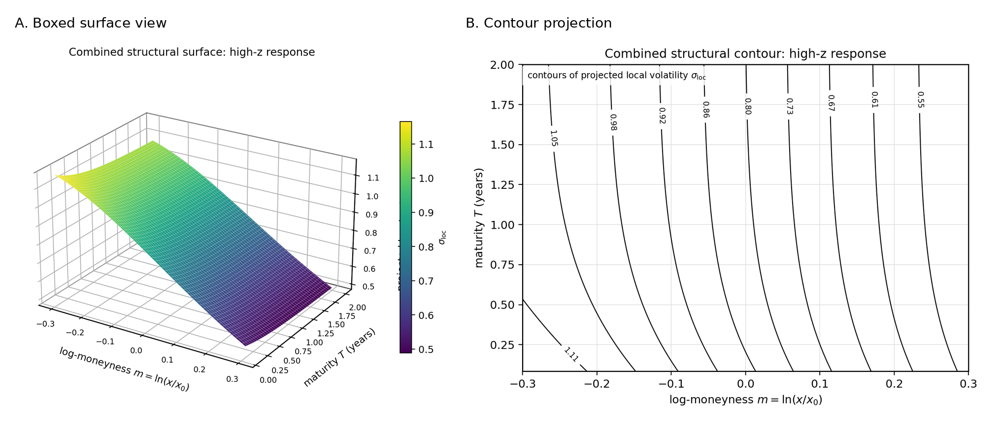

# Reaction-boundary volatility surface reproducibility bundle

**Current scientific checkpoint: v1.2.0.** The translating reaction boundary (W02) was accepted on 22 November 2026. W03 is in progress on prescribed causal liquidity feedback.

**Repository:** [timgebbie/reaction-boundary-vol-surface-reproducibility](https://github.com/timgebbie/reaction-boundary-vol-surface-reproducibility)

**Accepted W02 source:** [`b65bf06`](https://github.com/timgebbie/reaction-boundary-vol-surface-reproducibility/commit/b65bf066e28466faa6781548a1f21e1b994e780c)

**Accepted W01 source:** [33332cfd7ce707079e6bac288b739aa28d6837bd](https://github.com/timgebbie/reaction-boundary-vol-surface-reproducibility/commit/33332cfd7ce707079e6bac288b739aa28d6837bd)

**Project type:** Quantitative-finance research reproducibility bundle

Published baseline: [v1.0.0](https://github.com/timgebbie/reaction-boundary-vol-surface-reproducibility/releases/tag/v1.0.0). The v1.0.1 preservation checkpoint on `main` is recorded in the [baseline audit](docs/audits/baseline-v1.0.0.md).

Supplementary code and materials for:

> Chris Angstmann and Tim Gebbie, **"Reaction-boundary variance and adjoint-consistent local-volatility projection"**, [arXiv:2607.05011v4](https://arxiv.org/abs/2607.05011v4).

The supplementary-materials document is included here:

> [ReactionBoundaryVolSurface-Supplement-v0.1.pdf](supplementary-materials/ReactionBoundaryVolSurface-Supplement-v0.1.pdf)

This repository is a quantitative-finance reproducibility bundle. Its purpose is to show how the reaction-boundary variance construction generates projected local-volatility surface shapes from liquidity, resilience, and response terms. The code is included so that the figures, tables, diagnostics, and sensitivity checks can be regenerated from the same parameter profiles used in the supplementary materials. This is slightly over-engineered so that it can be easily extended for more sophisticated simulation and calibration work if required. 

## Key figure: combined structural high-z response



**Figure. Combined structural reaction-boundary volatility surface under the high- $z$ response regime.** Panel A gives the boxed surface view of the projected local volatility $\sigma_{\mathrm{loc}}$ over log-moneyness $m=\ln(x/x_0)$ and maturity $T$. Panel B gives the corresponding black-line contour projection of the same surface. This is the key pair in the supplement because it shows the point of the exercise: the model is not fitting an option-implied surface, but generating a structurally interpretable local-volatility shape from reaction-boundary ingredients. The high- $z$ case emphasises the response-sensitive regime in which liquidity, resilience, and the structural response profile combine to produce a persistent skew-like surface over maturity. The contour view is included because it is easier to compare shape, monotonicity, and curvature across regimes without the visual distortion of a 3D perspective plot.

The combined high-$z$ figure uses the profile definitions and the high-$z$ asymptote in the v1.0.0 structural-surface calculation. The sensitivity summary reports the numerical characteristics of all six surfaces. [Profile definitions](config/profile-definitions-v1.json) · [Sensitivity summary](outputs/stage09-sensitivity-summary-v1.csv) · [Figure register](figure-table-provenance-register.csv)

## Current situation: v1.2.0 accepted

The accepted v1.1.0 calculation returns the operational increment variance of the stationary frozen boundary at positive microscopic cutoff. Its independent time-domain evaluation gives a direct check on the spectral calculation in Appendix A of the paper. The original structural surfaces remain the published baseline.

The v1.2.0 calculation asks what changes when the deposition profile follows the observed zero. In the auxiliary field the translated profile has a neutral tangent, while the shape sector retains the resilience gap. With forcing proportional to that tangent, the zero follows the translation coordinate exactly. An orthogonal shape perturbation can shift the zero even when its spectral phase vanishes. [Translating-front calculation and tests](docs/audits/translating-front-v1.2.0.md)

### Historical structural-surface baseline: v1.0.0

The current v1.0 bundle supports the claim that a reaction-boundary variance closure can be projected into local-volatility-like surfaces whose shape reflects structural order-book ingredients rather than direct option calibration.

In this current situation:

- reproducible simulations for the liquidity-only, resilience/response-only, and combined structural regimes;
- low-\(z\) and high-\(z\) response cases;
- surface and contour representations of the projected local-volatility surfaces;
- parameter tables linking the mathematical construction to the numerical profiles;
- diagnostics and sensitivity checks used to verify the active simulation route;
- the supplementary-materials PDF and LaTeX source.

This is a **simulation and interpretation bundle** for the supplementary materials. It is not an empirical market-data calibration, not a Dupire inversion from option prices, not a trading strategy, and not a production pricing library.

### Evidence inventory

| Identifier | Claim, experiment, or feature | Evidence artifact | Verification status |
|---|---|---|---|
| Structural surfaces | Three structural profiles in the low- and high-$z$ regimes | [Diagnostics](diagnostics/stage07-diagnostics-v1.csv) · [Sensitivity checks](diagnostics/stage09-sensitivity-checks-v1.csv) | 42 diagnostics and 19 sensitivity checks passed in the baseline replay. |
| Frozen increment variance | Independent spectral and time-domain evaluations at finite cutoff | [48 comparisons](outputs/v2/frozen-variance-checks.csv) · [Audit](docs/audits/frozen-response-v1.1.0.md) | Maximum observed relative discrepancy $3.84\times10^{-11}$ on the stated grid. |
| SV2-F01 | Cutoff dependence and the full zero-cutoff crossover | [Figure](figures/v2/response-crossover.svg) · [Figure data](outputs/v2/response-crossover.csv) | Reproduced on the recorded Linux environment. |
| Translating front (W02) | Pinned and moving spectra, translated root, weak field residual across the zero | [Spectra](outputs/v2/translation-spectrum.csv) · [Root and residual](outputs/v2/aligned-root-checks.csv) · [Mode figure](figures/v2/translation-modes.svg) | Eight W02 tests passed. The field and the placement of forcing are specified by the auxiliary construction. |

### Prior implementations and methodological antecedents

| Source | Exact version / commit | Reused or adapted element | Differences and checks |
|---|---|---|---|
| [Frozen TeX and bibliography](provenance/source-freeze/SOURCE-FREEZE.md) | FMF v1.8 source freeze | Source used in developing the original asymptotic surfaces | Both source hashes verified in the preservation audit. |
| [Reaction-boundary paper](https://arxiv.org/abs/2607.05011v4) | arXiv:2607.05011v4 | Eqs. (21) and (47), with Gaussian tangent-state conditioning in Appendix D | Separate implementations compare the finite-cutoff coefficient with the zero-cutoff crossover. |
| *Toward an Effective Field Theory of Market Microstructure* | Mathematical companion v1.0.0, 21 November 2026 | Auxiliary translating-front and feedback constructions for the extension | The companion has its own version history. Each numerical claim requires evidence on the operational clock used here. |

## Future situation: possible extensions

### Planned checkpoints through v2.0.0

| Checkpoint | Scientific question or evidence |
|---|---|
| v1.0.1 and v1.1.0 (accepted) | Replay the released surfaces and verify the frozen, finite-cutoff boundary variance independently in frequency and time. |
| v1.2.0 (accepted) | Resolve the translation mode and stable shape spectrum, and test the exact aligned moving root. |
| v1.3.0 | Introduce prescribed liquidity feedback and quantify the response error from eliminating fast rates. |
| v1.4.0 | Measure the integrated root propagator and input memory independently to test the Bouchaud balance. |
| v1.5.0 | Measure actual-root variance on the same prespecified operational-time window, including off-match and finite-rate-floor controls. |
| v1.6.0 and v1.7.0 | Measure phase–shape covariance, then test root preservation and convergence for a nonlinear, non-aligned front. |
| v1.8.0 and v1.9.x | Compare mechanisms and controls, then audit claims and reproduce the expanded supplement from a clean checkout. |
| v2.0.0 | Assemble the verified results and their limits in a citable code and supplement milestone, subject to approval. |

### Beyond v2.0.0: an effective field theory from bid and ask liquidity

Can the separately evolving bid and ask densities, with depletion and delayed, displaced replenishment, supply the kinetics for an effective theory of the moving boundary? A first comparison would extract the zero of the simulated signed imbalance wherever it is unique and simple, and measure its displacement alongside the threshold-quote log midpoint and quoted spread on the same operational clock. The difference between the root and the midpoint would itself be an observable. Matched perturbations of replenishment placement or delay could then test whether a single boundary coordinate predicts the measured response, or whether spread or pending replenishment must remain explicit slow variables. A further question is whether the measured relaxation spectrum accounts for the feedback law currently prescribed in the auxiliary model. [Two-field spread paper](https://arxiv.org/abs/2610.07985) · [Simulated density paths, quotes and controls](https://github.com/timgebbie/two-field-spread-reproducibility)

### Other possible extensions

Other directions include:

- compare the simulated reaction-boundary surfaces with empirical option-implied local-volatility surfaces;
- calibrate liquidity, resilience, and response profiles from order-flow or limit-order-book data;
- study whether the high-\(z\) and low-\(z\) regimes correspond to identifiable market states;
- connect the reaction-boundary surface shape to long-memory order-flow effects and Hurst-type response behaviour;
- examine how no-arbitrage projection or regularisation would interact with the structural surface;
- extend the sensitivity analysis to richer parameter sweeps and alternative response kernels.

Possible software improvements include: formal packaging, command-line entry points, notebooks, continuous integration, and locked environments, are useful future enhancements. 

## Scientific boundary

The code simulates projected structural volatility surfaces from the reaction-boundary variance construction. It does not estimate a calibrated Dupire local-volatility surface from market option data. The local-volatility comparison in the supplement is qualitative and phenomenological.

The high-$z$ figures illustrate the unconditional stationary variance response. Using that response as a state-conditioned pricing coefficient requires separate justification.

## Repository structure

```text
VERSION_POLICY.md        Checkpoint acceptance, tags and major releases
tests/                   Claim-bearing numerical checks for the extension
docs/audits/             Baseline replay and checkpoint evidence
outputs/v2/              Supplement extension data, including pre-v2.0.0 work
figures/v2/              Supplement extension figures
config/                  Parameter ranges and profile definitions
functions/               Reusable numerical helpers
scripts/                 Active v1.0 reproducibility scripts
data/                    Data instructions; no empirical data are required
figures/                 Preferred generated v3 figure outputs and README figure
tables/                  Generated CSV and LaTeX tables
diagnostics/             Diagnostic and sensitivity-check reports
outputs/                 Sensitivity summary outputs
captions/                Standalone caption drafts for generated figures
supplementary-materials/ Supplementary-materials TeX and PDF
provenance/              Stage notes, audits, registers, source freeze, legacy scripts
```

## Installation

The historical Windows author run used Python 3.13.9. The November replay and v1.1.0–v1.2.0 calculations used Linux, Python 3.12.14, NumPy 2.3.5, SciPy 1.17.0 and Matplotlib 3.11.0. The requirements files specify the supported installation constraints. The exact versions above identify the recorded run.

### Obtain the accepted scientific source

```bash
git clone https://github.com/timgebbie/reaction-boundary-vol-surface-reproducibility.git
cd reaction-boundary-vol-surface-reproducibility
git checkout b65bf066e28466faa6781548a1f21e1b994e780c
```

For the original published surfaces alone, use the same repository at tag `v1.0.0`.

### Install dependencies

From a fresh clone:

```bash
python -m venv .venv
```

Activate the environment.

On Windows PowerShell:

```powershell
.venv\Scripts\Activate.ps1
```

On Windows CMD:

```cmd
.venv\Scripts\activate.bat
```

On macOS/Linux:

```bash
source .venv/bin/activate
```

Then install the requirements:

```bash
python -m pip install --upgrade pip
python -m pip install -r requirements.txt
```

For the finite-cutoff comparison and the extension tests, install the additional response requirements in the same environment:

```bash
python -m pip install -r requirements-response.txt
```

## Reproducing the accepted outputs

### Inputs and configuration

| Input | Source / location | Version or fingerprint | Access conditions |
|---|---|---|---|
| Structural profiles and parameter ranges | [Profiles](config/profile-definitions-v1.json) · [Ranges](config/parameter-ranges-v1.csv) | Released v1.0.0 Git tree | Public synthetic inputs. |
| Frozen-variance quadrature and parameter grid | [Calculation](functions/frozen_response.py) · [Experiment](scripts/run_frozen_response.py) | Accepted v1.1.0 commit above | Deterministic calculation. The grid and numerical tolerances are given in the audit. |

### Reproducing the active outputs

Run the convenience wrapper:

```bash
python scripts/run_all.py
```

or run the scripts explicitly:

```bash
python scripts/03_run_diagnostics.py
python scripts/01_make_tables.py
python scripts/05_generate_matplotlib_figures_v3.py
python scripts/06_run_sensitivity_checks.py
```

Running the active route regenerates or checks:

- tables in `tables/`;
- preferred v3 figures in `figures/`;
- diagnostics in `diagnostics/`;
- sensitivity summaries in `outputs/`;
- figure captions in `captions/`.

### Finite-cutoff and translating-front calculations

```bash
python -W error -m unittest discover -s tests -v
python -W error scripts/run_frozen_response.py
python -W error scripts/run_translating_front.py
```

| Output | Location | Format | Acceptance criterion |
|---|---|---|---|
| Six structural surfaces and sensitivity summary | [Figures](figures) · [Summary](outputs/stage09-sensitivity-summary-v1.csv) | PNG, PDF, CSV | Baseline diagnostics and sensitivity checks, with rendering and rounding differences recorded. |
| Finite-cutoff coefficient | [Comparisons](outputs/v2/frozen-variance-checks.csv) | CSV | Relative discrepancy and refinement changes below $10^{-6}$ for each of 48 cases. |
| Crossover and its running slope | [Figure](figures/v2/response-crossover.svg) · [Data](outputs/v2/response-crossover.csv) | SVG, CSV | Low- and high-$z$ checks against Eq. (22), using the tolerances in the [tests](tests/test_frozen_response.py). |
| Translating front | [Field and root tests](docs/audits/translating-front-v1.2.0.md) · [Root residuals](outputs/v2/aligned-root-checks.csv) | CSV, SVG | On the finest grid the aligned weak residual was $3.16\times10^{-5}$ and the displaced-forcing control gave 0.218. |

### Repeating the analysis in an already-used tree

The same commands regenerate the derived files in place. Use the reference checkout above to compare against the accepted outputs. For an existing checkout, inspect local edits before rerunning the figure and table scripts.

## Verification status

| Check category | Command or evidence record | Result |
|---|---|---|
| Environment and dependencies | [Baseline replay](docs/audits/baseline-v1.0.0.md) · [Finite-cutoff run](docs/audits/frozen-response-v1.1.0.md) | Recorded on 22 November 2026. |
| Unit and scientific regression | Clean W02 replay | All 13 tests passed with warnings treated as errors. Five cover W01 and eight cover W02. |
| Source integrity | [Source freeze](provenance/source-freeze/SOURCE-FREEZE.md) · [Inventory reconciliation](docs/audits/baseline-v1.0.0.md) | Frozen TeX and BibTeX verified. The staged inventory differs from the Git tree. |
| Clean source reproduction | Independent checkout of the v1.1.0 tree | Both extension CSVs and the SVG regenerated byte-for-byte in the recorded environment. All 61 historical checks passed. |
| Cross-platform evidence | [Original author and clean-clone report](TEST-REPORT-v1.0.md) | Windows evidence applies to the historical route. The extension was verified on Linux. |

### Execution gates passed

The reduced v1.0 bundle has passed two execution gates:

1. **Author local execution gate:** Windows, Python 3.13.9, `venv` under an Anaconda installation. The author confirmed successful completion of Stage 7 diagnostics, Stage 8 table generation, Matplotlib v3 figure generation, and Stage 9 sensitivity checks.
2. **Private GitHub clean-clone gate:** the private GitHub repository was cloned into a fresh directory, dependencies were installed into a fresh virtual environment, and `python scripts/run_all.py` completed successfully.

The expected final status line is:

```text
Active v1.0 reproducibility route completed successfully.
```

The original staged workspace recorded:

- Stage 7 diagnostics: 42 checks, 0 failures;
- Stage 9 sensitivity checks: 19 checks, 0 failures.

### Note on regenerated PDF figures

Running the figure-generation script may cause Git to mark generated PDF figures as modified even when the run has succeeded. This is expected: Matplotlib PDF output can differ byte-for-byte across local systems because of backend metadata, font embedding, or rendering details. The reproducibility claim is that the scripts regenerate the intended scientific figures, tables, diagnostics, and sensitivity checks; it is not a claim of byte-identical PDF files across all machines.

## Version-control and release policy

Development proceeds on `main`. Accepted checkpoints can receive immutable version tags. GitHub releases require a separately approved major scientific or reproducibility milestone. See the [version policy](VERSION_POLICY.md).

| Version or stage | Verified change | Evidence / status | Release reference |
|---|---|---|---|
| v1.0.0 | Original structural surfaces, diagnostics and v0.1 supplement | Published reproducibility baseline | [Tag and GitHub release](https://github.com/timgebbie/reaction-boundary-vol-surface-reproducibility/releases/tag/v1.0.0) · [`ee37d99`](https://github.com/timgebbie/reaction-boundary-vol-surface-reproducibility/commit/ee37d994b72b64395560de1126531bb259c1f794) |
| v1.0.1 | Historical replay, source map and checksum reconciliation | Accepted preservation checkpoint · [audit](docs/audits/baseline-v1.0.0.md) | [`48aad39`](https://github.com/timgebbie/reaction-boundary-vol-surface-reproducibility/commit/48aad392734a228455df743d1c9a6453c4fecee8) · commit on GitHub |
| v1.1.0 | Exact finite-cutoff cumulant, independent time-domain check and zero-cutoff crossover | Accepted scientific checkpoint · [audit](docs/audits/frozen-response-v1.1.0.md) | [`33332cf`](https://github.com/timgebbie/reaction-boundary-vol-surface-reproducibility/commit/33332cfd7ce707079e6bac288b739aa28d6837bd) · commit on GitHub |
| v1.2.0 | Translating profile, pinned control, stable shape band and measured root | [Computational audit](docs/audits/translating-front-v1.2.0.md) · accepted scientific checkpoint | [`b65bf06`](https://github.com/timgebbie/reaction-boundary-vol-surface-reproducibility/commit/b65bf066e28466faa6781548a1f21e1b994e780c) |

The public tag and hosted release at the 22 November audit were both v1.0.0. The v0.1 supplement, the paper revision, the EFT companion and the dated inputs and figure families each retain their own identifiers. The `v2/` output directories identify work towards the expanded supplement.

## Release archive and provenance

| Record | Reference | Scope |
|---|---|---|
| Archived software | [ZivaHub deposit](https://doi.org/10.25375/uct.32936867), `ReactionBoundaryVolSurface-Reproducibility-v1.0-stage5.zip` | Staged v1 software deposit. |
| Released Git source | [v1.0.0](https://github.com/timgebbie/reaction-boundary-vol-surface-reproducibility/releases/tag/v1.0.0) · [Release notes](RELEASE-NOTES-v1.0.md) | Reduced public repository and historical supplement. |
| Inventory | [Staged checksums](FILE-MANIFEST-SHA256.csv) · [Current source map](reproducibility-manifest.md) | Of 132 staged entries, 98 match tagged Git bytes, six match with CRLF conversion, 27 differ and one file is absent. |
| Frozen-response extension | [v1.1.0 source](https://github.com/timgebbie/reaction-boundary-vol-surface-reproducibility/tree/33332cfd7ce707079e6bac288b739aa28d6837bd) | Accepted mainline computation. The v1 deposit describes the staged historical archive. |
| Translating-front extension | [`b65bf06`](https://github.com/timgebbie/reaction-boundary-vol-surface-reproducibility/commit/b65bf066e28466faa6781548a1f21e1b994e780c) | Accepted W02 source, including the integrated clean replay. |

## DOI, citation, and license

Registered ZivaHub/Figshare DOI:

https://doi.org/10.25375/uct.32936867

Suggested citation:

Gebbie, Tim and Angstmann, Chris (2026). *Reaction-boundary volatility surface reproducibility code for arXiv:2607.05011*. University of Cape Town. Software. https://doi.org/10.25375/uct.32936867

| Item | Value |
|---|---|
| Associated paper | [arXiv:2607.05011v4](https://arxiv.org/abs/2607.05011v4) |
| Supplementary PDF | [ReactionBoundaryVolSurface-Supplement-v0.1.pdf](supplementary-materials/ReactionBoundaryVolSurface-Supplement-v0.1.pdf) |
| GitHub repository | `https://github.com/timgebbie/reaction-boundary-vol-surface-reproducibility` |
| GitHub release | `https://github.com/timgebbie/reaction-boundary-vol-surface-reproducibility/releases/tag/v1.0.0` |
| ZivaHub/Figshare DOI | [`10.25375/uct.32936867`](https://doi.org/10.25375/uct.32936867) |
| ZivaHub/Figshare landing page | [`Code: Reaction-boundary volatility surface reproducibility code for arXiv:2607.05011`](https://zivahub.uct.ac.za/articles/software/Reaction-boundary_volatility_surface_reproducibility_code_for_arXiv_2607_05011/32936867) |
| Code license | MIT License |
| Supplement/text/figures license | `[CC BY 4.0]` |

## License

Code is released under the MIT License.

Supplementary text, captions, figures, tables, and documentation are released under CC BY 4.0 unless otherwise stated.

The associated paper remains governed by its own arXiv/submission terms and is not relicensed by this repository.

See also `CITATION.cff` and `DOI-CITATION-LICENSE.md`.

## Current decision and next gate

The v1.1.0 checkpoint verifies the stationary frozen tangent variance on the operational clock. Independent spectral and time-domain calculations agree within $4\times10^{-11}$ across the 48 tested configurations. The accepted v1.2.0 checkpoint verifies the neutral translation mode and stable shape spectrum. See the [scientific audit and reproduction commands](docs/audits/frozen-response-v1.1.0.md) and the [crossover figure](figures/v2/response-crossover.svg).


| Decision record | Current position |
|---|---|
| Current situation | W02/v1.2.0 accepted on `main`. Published software baseline v1.0.0. |
| Future situation | Test the causal response of a prescribed distribution of liquidity-reassessment rates, then quantify error from eliminating fast rates. |
| Accepted evidence | Historical surface replay, independent frozen-variance comparison, and W02 spectrum and aligned-root residual. See the version table. |
| Unresolved issues | Historical archive reconciliation and the derivation of effective liquidity feedback from physical kinetics. |
| Decision required | Review the W03/W04 evidence when the v1.3.0 candidate is ready. A GitHub release requires a separate major-milestone decision. |
| Next gate | W03 tests prescribed causal feedback against independent time- and frequency-domain calculations. |
